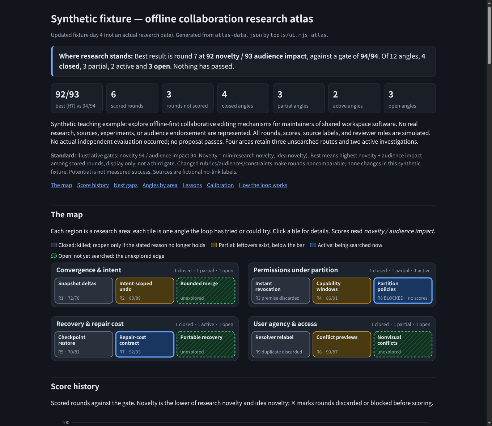
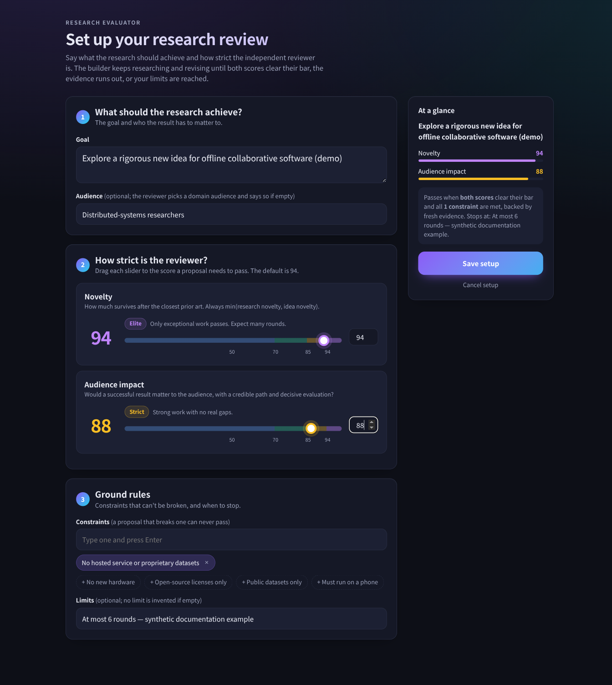
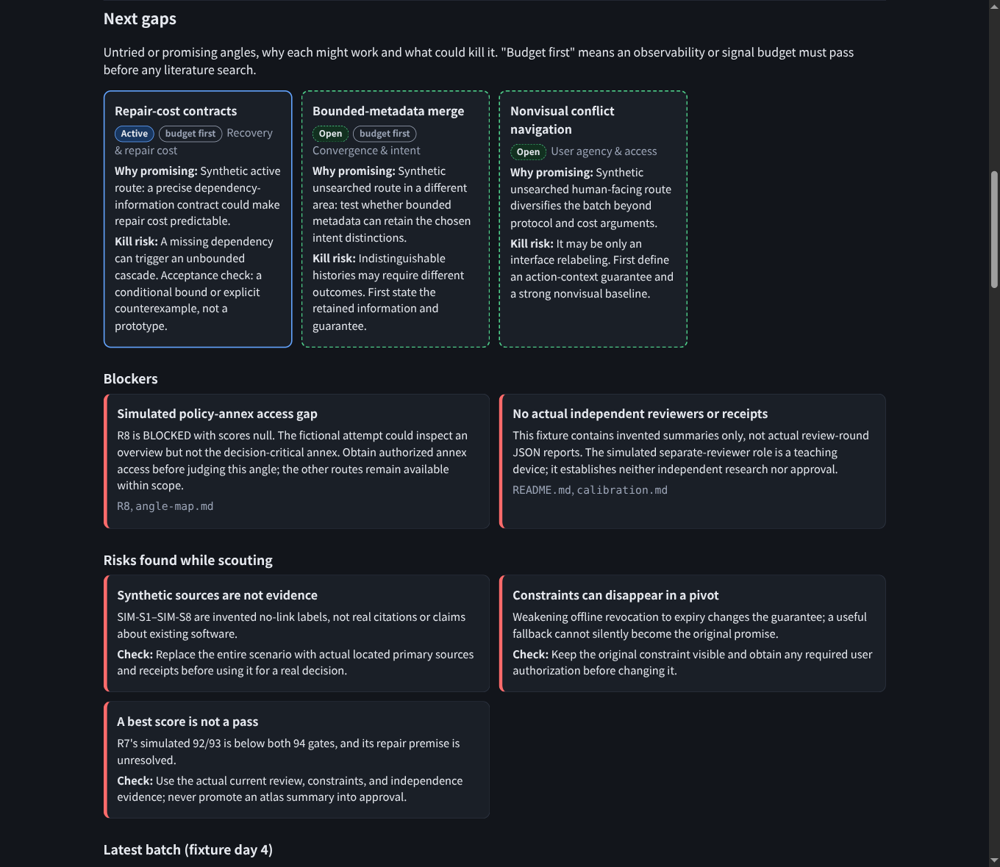
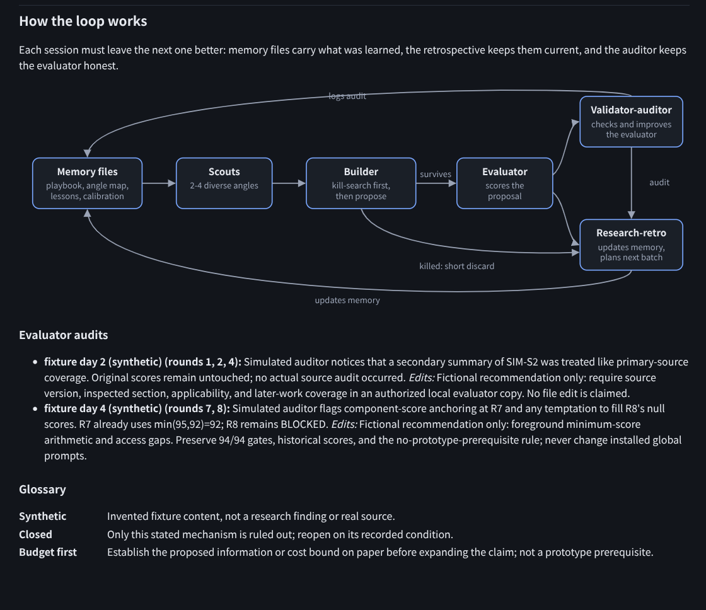

# research-evaluator

An evidence-first research-proposal reviewer and a builder-led research → proposal → independent review → revision loop. It now remembers what has been explored, maps the remaining gaps, learns from failed directions, and audits the evaluator itself—not just the proposals.

This is a Markdown prompt/Agent Skills repository, not a research service or a promise to invent patentable ideas. Installing it does not start research. Your assistant supplies the research tools and follows your project’s safety and permission policies.

- [Canonical standalone evaluator](agents/research-evaluator.md) — checks novelty and conditional value for your audience.
- [Validator auditor](agents/validator-auditor.md) — checks the evaluator's evidence, currency, consistency, and rubric drift.
- [Research retrospective](agents/research-retro.md) — updates shared memory and plans a better next batch.
- [Builder-loop skill](SKILL.md) — coordinates those roles without letting them change your acceptance criteria.
- [Example project brief](examples/project-brief.md) · [Memory templates](templates/research-memory/) · [Worked research atlas](examples/research-memory/)



*Actual generated UI, using the explicitly fictional offline-collaboration example. The scores and findings are demonstration data, not real research results or approvals.*

## What changed

- **UI-first launch:** invoking the full skill opens setup immediately, before chat questions. No project folder is required: the launcher uses a temporary session unless you explicitly authorize a persistent directory.
- **Research memory:** a playbook, explored/unexplored angle map, lessons, estimate calibration, and evaluator audit log survive between sessions. Closed ideas keep their sources, closure reason, leftovers, and condition for reopening.
- **Two feedback paths:** the auditor improves evidence-backed evaluator instructions; the retrospective improves the research process and next batch. Neither can rewrite historical scores, lower gates, relax constraints, or guarantee success.
- **A visual research atlas:** territory map, score history, next gaps, blockers, risks, lessons, calibration, and audit findings in one offline HTML page. A coverage check detects angles missing from either the notes or the atlas.
- **Sharper evaluation:** creativity beyond merely being unpublished; a named hard technical contribution; fresh searches in neighbouring fields and recent work; source limitations kept within scope; score changes justified by changed criteria.

The atlas is a view of saved research notes, not an automatic research service. Agents maintain its JSON and Markdown; rendering it does not launch agents, watch files, browse sources, or rescore proposals.

## Install: choose one route

### Standalone agents

Clone into a new destination, then copy the self-contained agent files. Install just the evaluator for single reviews, or all three for the feedback loop. These commands assume the destination repository does not already exist:

```sh
git clone https://github.com/ZacharySF/research-evaluator
cd research-evaluator
mkdir -p ~/.omp/agent/agents
cp -i agents/*.md ~/.omp/agent/agents/
```

For Claude-style agent directories, use this alternative copy destination:

```sh
mkdir -p ~/.claude/agents
cp -i agents/*.md ~/.claude/agents/
```

Keep existing files when prompted; inspect and reconcile them rather than overwriting. Agent discovery, reload, and native subagent support depend on the host. A directory convention alone does not guarantee support. Follow your host’s instructions, or explicitly ask the assistant to read the agent file as below.

The auditor does **not** get permission to edit your installed/global evaluator by being installed. If you authorize evaluator improvements, give it a separate project-local copy and an exact writable path. Otherwise it returns proposed changes only. The retrospective writes only the explicitly authorized research-memory files; the evaluator remains read-only.

### Full skill: keep the repository together

Clone directly into a new skill directory:

```sh
mkdir -p ~/.agents/skills
git clone https://github.com/ZacharySF/research-evaluator ~/.agents/skills/research-evaluator
```

Alternatively, from the repository cloned above, link the whole repository into an omp skill directory:

```sh
mkdir -p ~/.omp/agent/skills
test ! -e ~/.omp/agent/skills/research-evaluator && test ! -L ~/.omp/agent/skills/research-evaluator && ln -s "$PWD" ~/.omp/agent/skills/research-evaluator
```

Do not replace an existing destination. The skill loads `agents/research-evaluator.md` relative to `SKILL.md`, so copying only `SKILL.md` is insufficient. Automatic skill discovery/reload is host-dependent; explicit natural-language use works without a native skill command. The full skill's setup UI requires Node.js 18+ and a browser; the standalone Markdown agents do not. No package installation or companion skill is required.

### Plain Markdown / existing instructions

Ask your assistant to read `agents/research-evaluator.md`, or paste its instruction body (below the YAML frontmatter) into an existing instruction file. Retain your existing project safety policies and tool permissions. This route does not require agent or skill discovery; if the host cannot read local files, paste the text into the conversation instead.

## Use

Start with the [example brief](examples/project-brief.md), replacing its goal, audience, constraints, proposal, sources, and evaluation plan with your own. Give the assistant access to fresh primary sources, including relevant papers’ limitations and subsequent research. Supplied citations are leads, not a substitute for independent searching and reading.

### One independent review

> Read `agents/research-evaluator.md` and apply it to the following project brief and proposal. Perform one independent, read-only review using fresh primary sources. Do not implement changes or authorize publication. Return the prescribed JSON verdict with evidence and next action. [Paste brief.]

Use the installed file’s actual path if you are outside the repository. With a host-native agent, you can request that agent by name, subject to the host’s invocation conventions.

### Builder-led improvement loop

> Read `SKILL.md` and follow its research → proposal → independent evaluator → revision loop for this brief. Load the evaluator from `agents/research-evaluator.md` relative to that skill. Keep builder and reviewer responsibilities separate; use a separate reviewer context if available, otherwise disclose the independence limitation. Preserve source receipts and explain substantive changes between rounds. Respect my stated research limits. [Paste brief and limits.]

The builder researches and revises; the evaluator independently challenges overlap, residual contribution, feasibility, audience value, and constraints without building the proposal. A stalled candidate can pivot rather than merely rewording its claims. Stop when the configured criteria are satisfied, when evidence access is blocked, when a user-supplied limit is reached, or as `STAGNATED` when no materially new evidence, mechanism, or viable pivot remains. Preserve the last review and research receipts; stagnation is never a pass. There is no invented default round limit or promise that retries increase scores.

### UI-first setup and optional saved reports

Invoking the full skill opens setup before asking for a topic, audience, mode, scoring thresholds, constraints, or save location in chat. The page collects the research goal, audience, pass-score sliders, constraints, and limits. A bare invocation selects the improvement loop after Save; an explicit one-review request still runs only one review.

Node.js 18+ and a browser are required for setup, with no dependencies to install. Without `--dir`, the launcher creates an isolated operating-system temporary directory and returns its path alongside the URL. It does not write into your project. Save confirms the setup; Cancel or 30 minutes of inactivity stops setup without starting research. Temporary sessions are not durable storage and may be removed by the operating system.

```sh
node tools/ui.mjs setup                       # opens the UI; prints {"url": "...", "dir": "..."}
node tools/ui.mjs wait --dir <returned-dir>   # waits for Save or Cancel
```

The UI displays where setup will be saved. Research records stay in conversation unless you separately authorize a persistent project-local folder. To use an already authorized folder, pass it explicitly; existing saved values load for editing:

```sh
node tools/ui.mjs setup  --dir research/
node tools/ui.mjs wait   --dir research/
node tools/ui.mjs report --dir research/   # renders saved review-roundN.json files
```

If the browser cannot open automatically, use the printed URL. If the runtime is unavailable, the assistant reports the failure rather than silently starting a chat interview. A conversational fallback is available on explicit request. Direct use of the standalone evaluator remains independent of the setup UI.



### Persistent memory and the research atlas

Authorize a research folder when starting a loop:

> Use the research-evaluator skill for this brief. Save the review packet and research memory in `research/`. After each judged round, have the validator auditor check the evaluator, then have the research retrospective update explored and unexplored angles, lessons, calibration, and the next batch. Keep the gates and constraints unchanged. Refresh the atlas after each batch. Propose evaluator instruction repairs unless I explicitly authorize a project-local copy to be edited.

From this repository, copy the empty templates into that authorized folder, keeping any existing files:

```sh
mkdir -p /path/to/project/research
cp -Ri templates/research-memory/. /path/to/project/research/
node tools/ui.mjs atlas --dir /path/to/project/research --check
```

Fill `meta` in `atlas-data.json` from the actual saved brief/setup, including its audience, thresholds, and constraints; template defaults do not override user settings. Add research outcomes only when supported by receipts. `atlas.html` is generated from `atlas-data.json`; `--check` also compares its angle names with `angle-map.md` before writing. Missing or stale rows fail with exit 1 and leave any previous HTML untouched. The check verifies coverage and basic data consistency, not the truth or completeness of the research. No browser or Python is required to generate the page; Node.js 18+ is sufficient.

| File | Carries forward | Maintainer |
| --- | --- | --- |
| `playbook.md` | Goal, audience, immutable gates/constraints, method, briefing requirements | Retrospective; user owns criteria |
| `angle-map.md` | Closed, partial, active, and open directions; evidence, leftovers, reopening condition | Retrospective |
| `lessons.md` | Evidence-backed failures and the checks that would catch them earlier | Retrospective |
| `calibration.md` | Scout estimates versus independent scores or unscored discard outcomes | Retrospective |
| `validator-audits.md` | Audit evidence, proposed/applied evaluator repairs, and any invalidated reliance | Auditor |
| `atlas-data.json` | Structured view of the same memory, rounds, frontier, risks, and audits | Retrospective |
| `atlas.html` | Offline visual view; regenerate rather than edit | Visual tool |

An **open** angle means not yet searched, not a proven research gap. A **closed** angle means the recorded reason defeated that candidate; it is not a claim that the entire field is solved. Scout estimates remain separate from evaluator scores; discarded and blocked rounds never acquire made-up scores.

If an audit finds a critical evidence error, preserve the original review but stop relying on its verdict. A fresh evaluator review under the unchanged criteria is required before accepting that candidate. An auditor cannot substitute its own scores.

Try the complete, fictional example without starting a research loop:

```sh
node tools/ui.mjs atlas --dir examples/research-memory --check --no-open
# Open examples/research-memory/atlas.html locally.
```

The [example guide](examples/research-memory/README.md) documents the JSON contract and maintenance workflow. For repeated updates, use `--no-open` and reload the page. Without file-write permission, keep the same memory and feedback receipts in the conversation instead; no files or atlas are silently created.





## Understand the result

Scores are subjective judgments on a 1–100 scale, not probabilities or measured achievements. Defaults are novelty ≥ **94** and audience impact ≥ **94**; set different thresholds in your brief when appropriate. Novelty is the minimum of research novelty and idea novelty, so a strong presentation cannot hide a weak contribution.

- **PASS:** both configured thresholds, project constraints, and sufficient independent evidence are satisfied.
- **REVISE:** the proposal falls short or contradicts a constraint; the review identifies a concrete next action.
- **BLOCKED:** required evidence or research tools are unavailable. `scores` is `null`, not guessed provisional numbers.

The canonical prompt defines the complete JSON contract, including `audience_impact`, prior-art overlap, limitations, residual contribution, uncertainties, questions, and an acceptance check for the next action. A missing prototype alone does not block proposal review: assess the potential of the proposed mechanism, not only an existing implementation. Decisive unknown feasibility can still prevent PASS. Hypotheses and planned measurements must not be reported as observed results.

Neither PASS nor a high score guarantees novelty, patentability, publication, endorsement, or practical success. The reviewer does not approve publication; that decision remains with the user and any applicable review process.

## Development and validation

This repository ships Markdown instructions and optional JavaScript tools, not a compiled application, so there is no application typecheck target. [Evaluator scenarios](evals/README.md) and [feedback-role scenarios](evals/feedback-loop.md) cover missing access, prior-art overlap, constraints, audit authority, and memory reuse. Run them with an assistant and report actual evidence; a prompt containing the right words is not proof of behavior.

CI runs Markdown lint and the visual tools' unit tests, not live-model evaluations. Run the same checks locally with Node.js 24:

```sh
npx --yes markdownlint-cli2@0.24.0 '**/*.md'
node --test 'tools/test/*.test.mjs'
```

Node.js is required for these development checks and the full skill's setup UI. Direct use of the standalone Markdown agents does not require it.

## License

[MIT](LICENSE), copyright 2026 ZacharySF.
