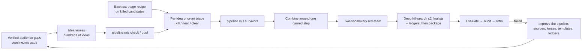

# research-evaluator

An evidence-first proposal reviewer and a builder-led research loop. Each round runs: hundreds of ideas → per-idea prior-art triage → one combined candidate → independent review → evaluator audit → retrospective → pipeline improvement. You configure a **custom rubric** with arbitrary scoring sections, judged in **potential or measured** mode. The loop keeps durable research memory and an atlas, and every judged round gets an evaluator audit and a process retrospective.

Installing it does not start research, authorize implementation, or approve publication. Your assistant supplies research tools and follows project permissions.

- [Packaged evaluator](agents/research-evaluator.md): reviews every configured rubric section and all hard constraints.
- [Packaged auditor](agents/validator-auditor.md): checks evaluator evidence, currency, consistency, and rubric drift.
- [Packaged retrospective](agents/research-retro.md): maintains memory, improves the idea pipeline after failures, and selects a better next batch without changing acceptance criteria.
- [Idea lens](agents/idea-lens.md): generates a schema-checked batch of ideas through one lens, anchored on verified audience gaps.
- [Prior-art triage](agents/prior-art-triage.md): finds the closest existing work for each idea (kill/near/clear), red-teams a carried step, and backtests its own recipe.
- [Builder-loop skill](SKILL.md) · [Example brief](examples/project-brief.md) · [Empty memory templates](templates/research-memory/) · [Fictional worked atlas](examples/research-memory/).

## Role safety

Keep the skill repository together, including `agents/`, `tools/`, and `templates/`. Back up the **original installed skill directory** and the original native `research-evaluator` definition before an explicitly authorized installation cutover. Preserve original project research folders, saved loops, `rubric.json`, and `evaluation-roundN.json` receipts; do not overwrite them with templates or synthetic examples. Backups are an installation policy, not a runtime scan or automatic discovery of other projects.

The packaged `agents/*.md` definitions are authoritative **for this skill**. Supply each complete packaged instruction body to a fresh generic subagent context, rather than selecting a similarly named global role. Other installed agents with the same names (for example project-specific `meta-evaluator`, `validator-auditor` or `research-retro` agents) may have incompatible instructions: do not overwrite them, invoke them by name as substitutes, or edit them.

The auditor has no installation/global write authority. An evaluator repair needs explicit permission and an exact project-local writable definition path; otherwise return a recommendation. The retrospective writes only authorized project memory. Neither role may change criteria, constraints, historical scores, or verdicts.

This source tree does not itself perform installation. Follow your host's skill discovery/reload instructions after a backed-up, authorized cutover. To use the prompts without native discovery, ask the assistant to read [SKILL.md](SKILL.md) and the packaged role files explicitly. Node.js is needed only for the optional visual tools.

## Use your existing rubric

Start from the [example brief](examples/project-brief.md), then configure your actual topic, goal, audience, rubric sections, constraints, and mode. Existing `rubric.json` is the source of truth; template defaults never overwrite it.

The rubric contract is:

```text
{ topic, goal, audience, judge_mode: "potential" | "measured",
  sections: [{ name, threshold, requirements, scoring_guide }],
  hard_constraints, pass_rule, notes }
```

Sections are arbitrary, not fixed gates. The fresh template illustrates **Novelty ≥94**, **Impressiveness ≥94**, **Feasibility ≥80**, and **Evidence quality ≥80**. Add or rename sections and set thresholds through the actual rubric; synchronize the atlas from that saved configuration. By default every configured section and every hard constraint must pass. Preserve an explicitly configured alternative `pass_rule`; the atlas displays it without trying to interpret arbitrary rule text. All hard constraints remain binding.

- **Potential mode:** judge the supported potential of the proposed mechanism, not only what has been built. Missing a prototype alone is not a blocker. Distinguish feasibility arguments and planned measurements from observed results.
- **Measured mode:** require the actual measurements/evidence specified by the rubric. Do not turn a plan into a measured result or silently switch to potential mode.

### One review

> Read the packaged `agents/research-evaluator.md` and apply my saved `rubric.json` to this proposal. Use a fresh reviewer context with those complete instructions, independently inspect primary sources, and return one custom-rubric JSON review. Do not implement, start a hidden loop, or publish anything.

### Builder-led loop

> Read `SKILL.md` and follow its loop using my existing rubric and saved research folder: build each new candidate from a large triaged idea pool, then independent review, audit, retrospective and a pipeline improvement after every failed round. Preserve all original research and receipts. Use the packaged roles in fresh contexts; do not select similarly named native roles. Keep every configured section, hard constraint, and judging mode unchanged. Stop at my limits or when no materially new evidence, mechanism, or viable pivot remains.

The builder researches and revises; the evaluator challenges the proposal without building it. Without independent contexts/tools, disclose sequential mode and its limitations, not independent approval. Stagnation is not a pass, and there is no invented default round limit.

### Idea pipeline

A new candidate is never one person's idea polished over and over. Each round builds a fresh pool, and the best ideas are combined only after each has survived a prior-art check:



```sh
node tools/pipeline.mjs gaps --out research/gaps/candidates.jsonl --max-posts 50 <feed-url>...   # unverified candidate gap sentences
node tools/pipeline.mjs check research/ideas/round5-LENS.jsonl                                    # schema, malformed lines, duplicate ids
node tools/pipeline.mjs pool --dir research --batch 6                                             # dedupe, drop self-rated low, write triage/batch-NN.json
node tools/pipeline.mjs survivors --dir research                                                  # triage rows → triage/survivors.md (clear, then near)
```

The commands are deterministic bookkeeping. Language-model work (ideation, triage, red-teaming, review) is done by the packaged roles. Triage novelty values are predictions for calibration, never judge scores. Gap candidates are keyword matches that must be confirmed against the source page before use.

## Setup UI (opens first) and report

Invoking the loop opens the browser setup page before any chat questions. With Node.js 18+ and no folder argument it uses an isolated temporary session and writes nothing into your project:

```sh
node tools/ui.mjs setup                      # prints {"url": ..., "dir": "<temp session>"}
node tools/ui.mjs wait --dir <returned-dir>  # Save → rubric.json in that session
```

Pass `--dir research/` (plus optional `--topic`/`--audience`) only for a project folder you have authorized; an existing `rubric.json` there loads for editing. The page shows where it saves. Chat setup is a fallback after a launch failure or on request.

```sh
node tools/ui.mjs report --dir research/
```

All entry points live under [`tools/`](tools/); there is no root-level shim. Setup saves `research/rubric.json`; reviews remain `research/evaluation-roundN.json`, and report renders `research/report.html`. Keep existing rubrics and receipts rather than replacing them with a different report schema. Setup supports arbitrary sections, requirements, scoring guides, thresholds, hard constraints, and potential/measured mode.

The native custom report shape remains:

```text
{ verdict, round,
  sections: [{ name, score, threshold, passed, why, lacking }],
  prior_art: [{ title, url, overlap, what_remains_new }],
  fact_checks: [{ claim, status, evidence }],
  grill: [{ question, recommendation }],
  loopy_receipt, next_research_action, summary }
```

A `BLOCKED` report retains every configured section with `score: null` and `passed: false`; never fill unknown scores with numeric placeholders. The report and atlas are different projections of saved research, not interchangeable review schemas.

## Persistent memory and atlas

Authorize a project research directory, then copy empty memory templates **without replacing existing files**:

```sh
mkdir -p /path/to/project/research
cp -Ri templates/research-memory/. /path/to/project/research/
node tools/ui.mjs atlas --dir /path/to/project/research --check --no-open
```

Before real research, populate atlas metadata from the saved rubric: goal, audience/context, **all section names and thresholds**, judging mode, and constraint context. Empty areas, angles, and rounds are valid. Defaults are examples only. Record every scored section in each scored atlas round, use null/absent scores for blocked or discarded outcomes, and keep exact angle names synchronized with column 2 of `angle-map.md`.

| File | Purpose | Maintainer |
| --- | --- | --- |
| `rubric.json` | Actual rubric, mode, constraints, and acceptance rule | User owns criteria |
| `evaluation-roundN.json` | Verbatim custom evaluator report | Builder preserves receipt |
| `playbook.md` | Standing packet, permissions, method, next batch | Retrospective |
| `angle-map.md` | Closed/partial/active/open angles, evidence, leftovers, reopening | Retrospective |
| `lessons.md`, `calibration.md` | Scoped lessons and pre-review predictions versus actual scores | Retrospective |
| `validator-audits.md` | Source rechecks and permissioned repair recommendations | Auditor |
| `atlas-data.json` | Structured projection of memory and all configured score sections | Retrospective |
| `atlas.html` | Generated offline view, not review authority | `tools/ui.mjs atlas` |
| `gaps/` | Verified audience gap statements (authors, verbatim quotes, URLs) and unverified scraped candidates | Builder |
| `ideas/*.jsonl` | Idea pools, one file per lens, appended incrementally | Idea lenses |
| `triage/` | Pool batches, per-idea kill/near/clear rows, red-team receipts, `survivors.md` | Prior-art triage; `tools/pipeline.mjs` |

The [template schema guide](templates/research-memory/README.md) specifies the dynamic contract. `--check` checks schema/map consistency **before writing**, refuses missing/stale angle rows, and leaves previous HTML untouched on failure. It does not establish research truth. Rendering performs no research, agent invocation, source browsing, runtime directory scan, watching, or automatic rescore. Refresh explicitly after authorized changes.

“Best” is the highest total across comparable scored sections, **display only**, never another gate or a pass. Do not compare totals across different section sets, thresholds, rubrics, audiences, modes, or constraints as if they were a controlled improvement trend. An open angle is unsearched, not an established gap; closing one candidate does not solve a field. Scout estimates never become evaluator scores. A critical audit preserves the original receipt but invalidates reliance pending a fresh review under unchanged criteria.

Try the clearly fictional example without running research:

```sh
node tools/ui.mjs atlas --dir examples/research-memory --check --no-open
```

Its 12 angles and nine rounds include four statuses, an unscored BLOCKED round, two builder discards, and a candidate scoring above the first two thresholds but **failing Feasibility**. No fixture round passes. All source labels are fictional and intentionally have no links; no real evidence or independence is claimed.

### Live map

```sh
node tools/ui.mjs atlas --dir /path/to/project/research --live   # prints {"url": ...}; runs until stopped
```

A read-only viewer on 127.0.0.1. It opens paused (also before any checkpoint exists); turn on **Live map updates** to refresh every two seconds as the loop publishes checkpoints to `atlas-data.json` and `angle-map.md`, and turn it off to freeze the view for reference. Scroll and open sections are kept. Only valid checkpoints whose map rows match are shown; partial or mismatched writes keep the last valid map. It shows what the research has recorded, not every search in progress.

## Screenshot provenance

The [setup screenshot](docs/screenshots/setup.png), [atlas screenshot](docs/screenshots/atlas.png), [gaps screenshot](docs/screenshots/atlas-gaps.png), and [feedback screenshot](docs/screenshots/atlas-feedback.png) date from [PR #3](https://github.com/ZacharySF/research-evaluator/pull/3), when the evaluator used fixed novelty/audience gates. They show synthetic data, not the current custom-rubric UI, and are not research evidence. Render the tools locally to inspect the current UI.

## Understand the result

- **PASS:** the configured pass rule and every hard constraint are satisfied with evidence appropriate to the judging mode; by default all saved section thresholds must pass.
- **REVISE:** a criterion is unmet or unresolved; the reviewer gives a concrete next research action.
- **BLOCKED:** decision-critical evidence/access is unavailable; null scores and the exact prerequisite remain explicit.

Scores are subjective 1–100 rubric judgments, not probabilities. Neither PASS nor a high score guarantees novelty, patentability, publication, endorsement, or practical success. Publication remains the user's decision and subject to applicable review.

## Development

The [evaluator scenarios](evals/) and their observed results were recorded against the earlier two-gate contract; translate their expectations as described in [evals/README.md](evals/README.md). Local checks use Node.js 24:

```sh
npx --yes markdownlint-cli2@0.24.0 '**/*.md'
node --test 'tools/test/*.test.mjs'
```

These commands do not verify live-model independence or research quality.

## License

[MIT](LICENSE), copyright 2026 ZacharySF.
